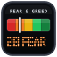
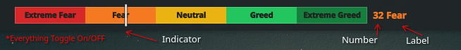
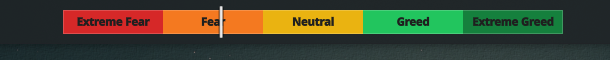

#  Fear & Greed Index for KDE Plasma (Panel Widget)

A fast, lightweight, and customizable panel widget for **KDE Plasma 6** that displays the **Fear & Greed Index** as a 5-segment Red-to-Green indicator bar with a live white position marker, numeric score, and current sentiment status directly on your desktop panel.

---

## Previews

### 1. Full Panel View (Default — Everything Toggled On)
Displays the 5-segment Fear & Greed indicator bar along with the live numeric score and status label on your panel:



### 2. Indicator Bar Only (Label and Number Turned Off)
Displays only the 5-segment Fear & Greed indicator bar with the status label and score number turned off:



---

## Features

- **5-Segment Red-to-Green Indicator Bar**: Displays **Extreme Fear**, **Fear**, **Neutral**, **Greed**, and **Extreme Greed** segments with a vertical white position marker line showing the exact 0–100 index value.
- **Score & Status Readout**: Shows the numeric index value (0–100) and current sentiment rating right next to the bar on your panel, dynamically colored to match the current Fear & Greed status.
- **Flexible Display Toggles & Custom Colors**: Independently toggle the **Indicator Bar**, **Segment Labels** (with configurable text color, automatically disabled when the indicator bar is off), **Score Number**, and **Status Text** on or off.
- **Free Public APIs (No API Key Needed)**:
  - **CNN Stock Market Fear & Greed Index** (Default)
  - **Crypto Fear & Greed Index** (`api.alternative.me`)
- **Configurable Refresh Interval**: Defaults to **120 seconds (2 minutes)** (~30 requests/hour), staying well below free API rate limits.
- **Configurable Width & Height**: Customize the indicator bar width and height in pixels (defaults: `360px` × `18px`, with all toggles enabled).
- **Multi-Instance Deduplication**: Shared `.pragma library` singleton (`api.js`) ensures multiple widget instances on your panels share cached responses.

---

## Directory Structure

```text
fear-and-greed-kde/
├── metadata.json              # Plasma 6 Applet metadata & plugin ID
├── contents/
│   ├── icons/
│   │   ├── org.kde.plasma.fearandgreed.svg # Custom high-res vector icon for Plasma and Store
│   │   └── org.kde.plasma.fearandgreed.png
│   ├── config/
│   │   ├── config.qml         # Settings category definition
│   │   └── main.xml           # KConfig schema (dataSource, updateInterval, barWidth, barHeight, toggles, color)
│   ├── ui/
│   │   ├── main.qml           # Inline panel widget UI
│   │   └── configGeneral.qml  # Settings UI
│   └── code/
│       └── api.js             # Shared singleton fetcher & cache manager
├── screenshots/               # Store preview screenshots and logo
│   ├── FGmaster.png           # Full widget preview (indicator, number, and label)
│   ├── FGindicator.png        # Indicator-only preview (label and number turned off)
│   └── logo.png               # High-res widget icon
├── LICENSE                    # GPL-3.0
└── README.md                  # Project documentation
```

---

## Installation & Development

### Local Installation / Upgrade

```bash
# Remove existing widget (if installed)
kpackagetool6 -t Plasma/Applet --remove org.kde.plasma.fearandgreed

# Install fresh copy
kpackagetool6 -t Plasma/Applet --install .
```

*(If Plasma Shell has cached a previous version in memory, restart it with `kquitapp6 plasmashell && kstart plasmashell`.)*

### Packaging for KDE Store

To create the `.plasmoid` bundle for uploading to [store.kde.org](https://store.kde.org):

```bash
zip -r org.kde.plasma.fearandgreed.plasmoid metadata.json contents/
```

---

## License

Distributed under the [GNU General Public License v3.0](LICENSE).
